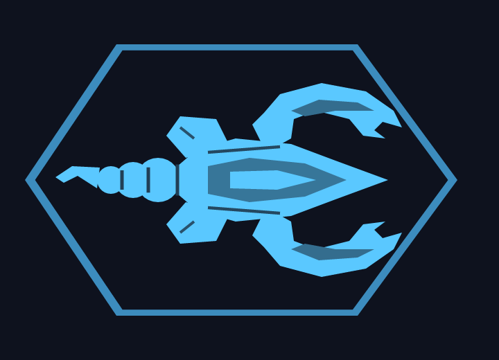

# Nova Drift Mod Loader

Unofficial mod loader for [Nova Drift](https://store.steampowered.com/app/858210/Nova_Drift/) (Steam, version 1.2.38.4).

- Change the stats of bodies, weapons, shields and mods with an INI file
- Add new gear to the game, sample profile **Scorpion**:
  - **BODY: SCORPION**: an extra 15th body with its own model, icon and stats
  - **WEAPON: STINGER TAIL**: stinger shots forward and an animated tail lash against pursuers that also bats enemy projectiles back
- Leaderboard score uploads are blocked while the loader is installed



## How it works

Nova Drift is built with GameMaker (YYC). The loader is a proxy `version.dll` that the game loads at startup. It hooks the compiled GML functions (`initializeVariables`, `assignBaseStats`, `getUpgrade*`, ...) and resolves every address at runtime by function name and byte pattern. The game files themselves are not modified.

## Installation

1. Download `version.dll` from the latest [release](../../releases).
2. Close Nova Drift and copy it into the game folder (Steam: right-click Nova Drift > Manage > Browse local files).
3. Start the game. On first start the loader creates `novadrift_mods.ini` and adds the Scorpion graphics and custom skin to `custom_skins`.

To remove it, delete `version.dll` from the game folder. To keep the loader but turn off the new gear, set `profile=` (empty) in `novadrift_mods.ini`.

## Building

Requires [Zig](https://ziglang.org/) as C compiler. Run from the repository root, since the profile and graphics are embedded from `profiles/`:

```bash
zig cc -O2 -shared -target x86_64-windows-gnu src/novadrift_mods.c src/version.def -o build/version.dll
```

## Usage

- Edit `novadrift_mods.ini` in the game folder; values apply from the next run.
- `[vars]`: tuning variables, see [variables.txt](variables.txt).
- `[weapon.Name]`, `[body.Name]`, `[shield.Name]`: base stats of a gear piece.
- `novadrift_mods.log` in the game folder lists changed values and the names of the equipped gear.

Profiles live in `profiles/<name>/`: stats, texts and custom skin row (`<name>.ini`) and graphics (`skin/`). The Scorpion profile is built into the DLL; other profiles are loaded from `novadrift_profiles\<name>.ini` in the game folder, with their graphics in `custom_skins`. Values in `novadrift_mods.ini` (e.g. `[weapon.Stinger]`) are applied on top of the profile. The graphics are generated by the Python scripts in `tools/` (requires `numpy`). In-game texts are `title`, `short` and `full`.

## Reverse engineering

- `tools/re_tables.py`: dumps the GML function table, variable/builtin slots, builtin registrations and objects (with parents) from `NovaDrift.exe` / `data.win` as JSON.
- `tools/annotate_decomp.py`: renames `FUN_`/`DAT_` in a Ghidra `decompile_all` export to GML, builtin and variable names. The result is decompiled game code; keep it local and never commit it.

## Notes

- The new gear only works with game version 1.2.38.4. After a game update the log reports what no longer matches.
- Continued runs do not remember the new gear and fall back to the standard body or Blaster.
- Not affiliated with the developers of Nova Drift. Use at your own risk and back up your saves first.
